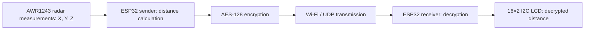

# Pioneering Secure Radar Data Systems for Advanced Automotive Safety

**Academic senior design project · Semester VII · 2024–2025 · KLE Technological University**

> **Repository status — documentation foundation.** This repository currently contains documentation only. Sender and receiver firmware, radar configuration, wiring diagrams, dependency manifests, assets, and reproducible test evidence have not been added.

This project report describes a radar-based distance measurement and secure wireless communication prototype using a Texas Instruments AWR1243 radar sensor, two ESP32 microcontrollers, AES-128 encryption, Wi-Fi, UDP, and I2C LCD output.

The report presents the sender as the component that acquires positional radar data, calculates an object distance, encrypts the result, and sends it wirelessly. The receiver obtains the packet, decrypts it, and displays the recovered distance on a 16×2 I2C LCD.

## Project goals

- Explore radar-derived object distance measurement.
- Process three-dimensional positional coordinates (X, Y, Z).
- Encrypt radar-derived data with AES-128 before wireless transfer.
- Transmit data between ESP32 devices over Wi-Fi using UDP.
- Demonstrate receiver-side decryption and LCD visualization.
- Document the hardware, implementation status, results, limitations, and security considerations.

The report frames the work as an educational ADAS and IoT prototype. It is not a certified automotive safety system and must not be relied on for vehicle control or collision avoidance.

## Reported project scope

The following describes the project report, not features verified in this repository:

- Radar positional data acquisition using a Texas Instruments AWR1243 sensor.
- 3D Euclidean/object distance calculation on a sender ESP32.
- AES-128 processing before Wi-Fi/UDP transmission.
- Reception, decryption, and distance display on a second ESP32 and I2C LCD.
- Sender and receiver LCD messages used to demonstrate communication status.
- SPI for radar interfacing and I2C for LCD interfacing.
- Arduino IDE and ESP-IDF are mentioned as development environments, but the exact environment used for the final firmware is not confirmed.

The report does not specify a formal output schema, the exact class of data transmitted, the AES mode, key provisioning, authentication mechanism, or replay protections. These details must not be invented.

## Processing overview



This diagram summarizes the reported design. The corresponding firmware, board configuration, and hardware integration are not present in this repository yet.

## Hardware

| Component | Reported use |
| --- | --- |
| Texas Instruments AWR1243 | Radar sensor and object positional measurements |
| 2 × ESP32 development boards | Sender and receiver units |
| 2 × 16×2 LCD modules | Sender/receiver status and decrypted distance output |
| I2C | LCD interface |
| SPI | Radar interface |
| Wi-Fi | Wireless transport between ESP32 units |
| UDP | Packet delivery protocol |
| USB cables / power supply | Board power and development |

Pin assignments, electrical connections, radar configuration, power requirements, and verified circuit diagrams are not included in this repository.

## Method and tools

| Component | Reported use |
| --- | --- |
| ESP32 | Embedded sender and receiver firmware |
| TI AWR1243 | Radar measurement acquisition |
| C/C++ embedded firmware | Radar and communication implementation |
| AES-128 | Data encryption and decryption |
| Wi-Fi | Network transport |
| UDP | Packet-based communication |
| SPI | Radar communication interface |
| I2C | LCD communication interface |
| Arduino IDE / ESP-IDF | Development environments mentioned in the report |

## Dataset

This project is not a machine-learning project and does not use a training dataset. The report describes live radar measurements under varying environmental conditions, but does not provide a recorded dataset, sample count, downloadable data, or a reproducible test log.

## Reported results

These are figures or demonstrations stated in the academic report. They have not been independently reproduced or validated from artifacts in this repository.

| Reported item | Report value | Evidence still needed |
| --- | --- | --- |
| Demonstrated output | `Decrypted Dist: 5.708` | Verified firmware, input units, test setup, and output capture |
| Encryption | AES-128 | Exact implementation and AES mode |
| Communication | Wi-Fi / UDP | Verified network configuration and packet format |
| Latency | No numerical measurement | Device configuration, timing method, sample count, and aggregation |
| Throughput | Not reported | Packet size, duration, network conditions, and test procedure |
| Packet loss | Not reported | Repeated test procedure and loss measurement |
| Distance accuracy | No numerical benchmark | Ground-truth method and statistical evaluation |

The report does not document the units associated with `5.708`, confidence intervals, or an accuracy percentage. It also does not report an encryption benchmark or packet-loss percentage.

## Repository contents

```text
.
├── README.md
├── CONTRIBUTING.md
└── docs/
    ├── IMPLEMENTATION_STATUS.md
    └── PROJECT_PLAN.md
```

This repository currently has no `src/`, `sender/`, `receiver/`, `hardware/`, `assets/`, `results/`, dependency manifest, or report PDF. These should be added only after the original project artifacts are available and verified.

## Setup and execution

There is currently no verified source code, board configuration, radar configuration, dependency manifest, or project-specific command sequence in this repository. Do not infer that a generic ESP32 AES or UDP example has been tested with this project.

Add setup instructions only after confirming:

- The firmware used for each ESP32.
- The source language and build environment.
- Board and library versions.
- Radar and LCD wiring.
- The AES implementation and mode.
- Wi-Fi, UDP, and key configuration procedures.
- Safe handling of network configuration and cryptographic secrets.

Never commit real Wi-Fi passwords, private AES keys, or credentials. Use local, untracked configuration and document safe setup steps separately.

## Limitations and security

- No sender or receiver implementation is present in this repository.
- The report does not provide quantitative performance benchmarks or a detailed real-world validation protocol.
- The exact AES mode, key-management approach, authentication, replay protection, and cryptographic validation are not specified.
- AES-128 by itself does not establish integrity or authentication for the complete communication system.
- The final radar integration status is not independently verified from repository artifacts.
- No documented testing covers a broad range of operating conditions or safety scenarios.
- This is an academic/research prototype. It is not safety-certified and must not be relied on for real-world vehicle control or collision avoidance.

## Roadmap and status

See [docs/PROJECT_PLAN.md](docs/PROJECT_PLAN.md) for the documentation and implementation roadmap and [docs/IMPLEMENTATION_STATUS.md](docs/IMPLEMENTATION_STATUS.md) for the distinction between report-described work and repository-verifiable work.

## Contributors and acknowledgements

**Project team**

- Vivekanand Naik
- Sunil Dyamakkanavar
- Chetan Havanagi
- Samarth G

**Project guides**

- Prof. Shraddha Hiremath
- Prof. Preeti Pillay

**Institution:** KLE Technological University, School of Electronics and Communication Engineering.

External technologies acknowledged in the report include Texas Instruments AWR1243 and Espressif ESP32. Verify third-party code and library licenses before redistributing firmware or dependencies.

## License

No license has been selected for original work in this repository. Dataset, upstream code, dependencies, sensor libraries, and model or firmware assets may have separate terms; check them before reuse or redistribution.

## Author

**Vivekanand Naik** · [GitHub](https://github.com/vivekanandnaikk) · [LinkedIn](https://www.linkedin.com/in/vivekanand-naik)
